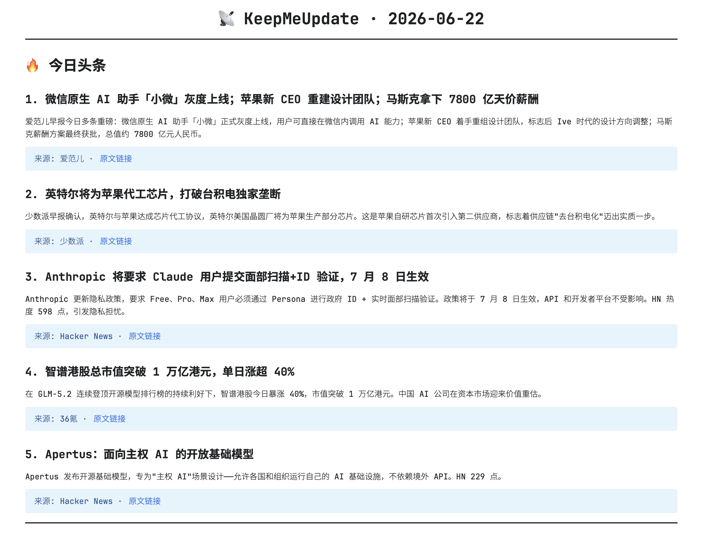

# KeepMeUpdate

每天一份有来源、可阅读、可归档的中文报纸：新闻事实 + 趋势与机会。支持 Codex、Hermes 等兼容 `SKILL.md` 的 agent；新增可由 Linux cron 直接运行的日报入口。

## 每天能得到什么

- 中国与社会、全球、商业经济、科技AI、科学生活的精选新闻；按事件合并，通常12–20条。
- 每条含事实导读、关注点、来源链接和发布时间。
- “趋势与机会”专栏：依据本期报道，写出判断、潜在需求、下一步验证、风险与反证，而非确定性预测。
- 可打印、适配手机宽度的 HTML 与适合 Typora 的 Markdown。
- 来源证据、抓取异常和运行记录，失败保留上一期。



## 本地每日自动运行

依赖 Python 3.9+、已登录的 Codex CLI、可用网络，以及 Linux cron。RSS和渲染使用标准库，不需 pip；模型编辑使用 Codex 账户额度，并非无模型成本。桌面通知可选，需要 `notify-send`。

```bash
git clone https://github.com/Nemocccc/KeepMeUpdate.git
cd KeepMeUpdate
cp config.example.json user_config.json
# 编辑 user_config.json 中的 output_dir、delivery_time 等设置
python3 scripts/daily_report.py --config user_config.json --collect-only
python3 scripts/daily_report.py --config user_config.json
python3 scripts/install_local.py --config user_config.json --dry-run
python3 scripts/install_local.py --config user_config.json
```

默认每天 Asia/Shanghai 08:00 生成。安装器创建 `~/.config/keep-me-update/config.json`，将此 checkout 链接到 `~/.codex/skills/keep-me-update`，并保留已有 cron 任务。开机时补做已过交付时间而尚未成功的当日报纸；关机或休眠时不会唤醒机器。

输出：

```text
output_dir/
├── 今日报纸.md               # Typora 阅读入口
├── 今日报纸.html             # 浏览器阅读入口
├── 往期报纸/
│   ├── 目录.md
│   └── YYYY-MM/
│       └── YYYY-MM-DD/
│           ├── 新闻报纸.md
│           └── 网页版.html
└── .运行记录/               # 隐藏的来源数据、日志、运行状态
    ├── cron.log
    ├── last-run.json
    └── YYYY-MM-DD/
```

同一天成功后重复运行会跳过；重做用 `--force`。已安装后手动生成：`python3 scripts/daily_report.py`。配置说明见 [references/config-flow.md](references/config-flow.md)。本机配置、运行数据与凭据不会提交到仓库。

## 作为 agent skill 使用

Codex 本地安装由上面的安装器完成。Hermes 用户可以将 checkout 安装到自己的 skill 目录：

```bash
cp -r KeepMeUpdate ~/.hermes/skills/keep-me-update
hermes --skills keep-me-update
```

可以说：“今天发生了什么，做一份报纸，并分析有哪些值得验证的机会。” Agent 先沿用已保存的偏好，补充缺失配置，再采集与编排。没有 Codex CLI 时仍可以由当前 agent 手动驱动采集、搜索和撰写；自动日报编辑默认使用 Codex。

旧科技RSS脚本仍可单独使用：

```bash
python3 scripts/rss_fetch.py --feeds scripts/rss_feeds.default.json
```

## 来源与质量

通用日报与原科技源列表分开维护。日报只收录发布时间明确、落在窗口内的条目，默认回看36小时。缺少日期不会冒充“刚发生”。候选ID与逐字摘录在程序中核对，链接由采集数据回填；404/410移除，付费墙/限流/超时标明访问状态。HTML中可展开来源证据。

RSS标题和摘要通常不能替代阅读全文；本报不声称独立核实所有报道，也不保证覆盖所有地区和领域。未来判断与新闻事实单列，提供证据、置信度及反证。详见 [来源边界](references/feed-behavior.md)。

邮件和飞书投递目前未内置；可在获得指定接收对象的授权后接入。建议邮件发送完整报纸，飞书推送要点与报纸入口。

## 开发检查

```bash
python3 -m unittest discover -s tests -v
python3 -m py_compile scripts/*.py
```

MIT · [Nemocccc/KeepMeUpdate](https://github.com/Nemocccc/KeepMeUpdate)
